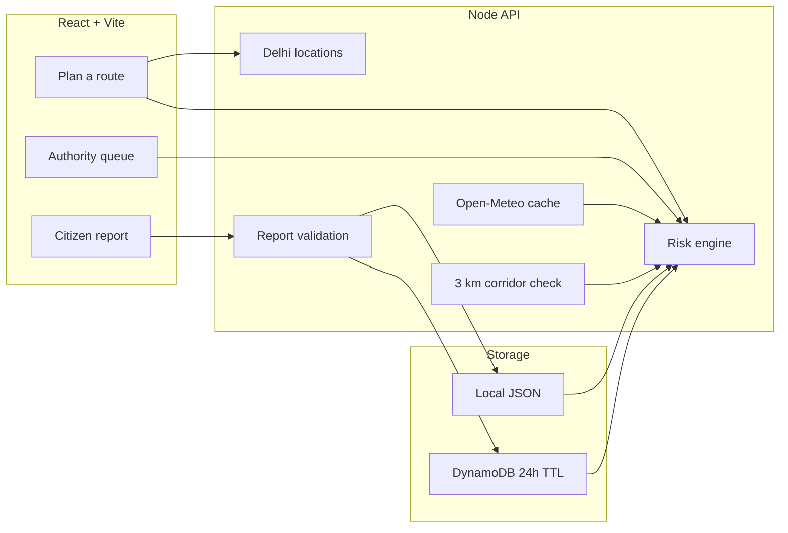

# FloodShield

FloodShield is a hackathon MVP for flood-aware travel decisions and a citizen-to-authority waterlogging response loop in Delhi.

It matches a commuter origin and destination to a Delhi location set, measures which monitored flood hotspots sit within **3 km of that corridor**, then scores the journey from four separate signals: Open-Meteo rainfall, hotspot sensitivity, citizen-report freshness/trust, and authority response status.

> **Limitation:** this is decision support, not an official warning system. The on-screen map is illustrative. The corridor is a geodesic between two known places, not a turn-by-turn roads model. It does not confirm closures, water depth, or send SMS/push alerts. Check official advisories and live directions before travelling.

## Why this exists

Delhi commuters usually get a city-wide rain forecast. Crews get scattered WhatsApp photos. FloodShield’s demo answers two questions:

- **Commuter:** is *this* journey exposed to a known waterlogging spot right now?
- **Authority:** which hotspot should get a crew first, and has that crew actually moved Assign → Start → Resolve?

## Features

- **Route-aware risk** using Delhi coordinates, not destination-name matching.
- Suggested Delhi locations in the planner to avoid free-text ambiguity.
- Open-Meteo precipitation for Delhi, cached 15 minutes, with a stale/fallback signal (never faked as live).
- Citizen reports with validation, 20-minute duplicate rejection, freshness, and trust.
- Authority queue ranked by baseline, rain, reports, and action state.
- Loading, unmatched-location, low-confidence, and no-data states in the commuter view.
- “Report this road” from the route result, which then updates the queue and the corridor score.
- Local JSON API plus a Lambda / API Gateway / DynamoDB deployment path.

## Architecture



**Local demo:** Vite (`:5173`) proxies `/api` to the Node server (`:8787`), which writes `backend/data/*.json`.

**AWS target (after the product is stable):** HTTP API Gateway → Lambda (`backend/src/handler.mjs`) → DynamoDB. Frontend static hosting (Amplify or equivalent) with `VITE_API_URL`. Weather still comes from Open-Meteo; only reports and actions are persisted.

If CloudFormation/SAM is blocked on the account, the same Lambda handler, table shape (`PK`/`SK`, `expiresAt` TTL), and HTTP routes can be created in the console. That is proof of AWS use, not a substitute for a working local product.

## Run locally

Node.js **20.19+** (22 recommended). From this folder, two terminals:

```bash
npm run api
```

```bash
npm install
npm run dev
```

Open the Vite URL (normally `http://localhost:5173`). First API start seeds three example reports.

## Test and build

```bash
npm test
npm run build
```

## Demo story (2–3 minutes)

Full script: [DEMO.md](./DEMO.md).

1. Plan **DTU, Rohini → Mandi House**. Mandi House Underpass is on the corridor.
2. Plan **Dwarka Sector 21 → Vasant Kunj**. Mandi House is *not* on that corridor.
3. Report severe waterlogging at Mandi House. Authority queue count and risk rise.
4. Assign → Start → Resolve. Commuter risk on the Rohini–Mandi corridor falls.

## API

| Method | Path | Purpose |
|---|---|---|
| GET | `/health` | Health and storage mode |
| GET | `/locations` | Suggested Delhi places and hotspots |
| GET | `/weather` | Cached forecast/fallback for Delhi |
| GET | `/risk?origin=&destination=` | Corridor risk, exposed hotspots, reasons |
| GET | `/reports` | Recent citizen reports |
| POST | `/reports` | Validate and persist a report |
| GET | `/authority/queue` | Ranked hotspot queue |
| POST | `/authority/actions` | Assign → Start → Resolve |

The local API allows CORS for hackathon use and has no authentication.

## AWS

See [DEPLOY.md](./DEPLOY.md). Deploy only after this product is stable and demoable locally. The SAM template is the intended path; use the console checklist in that file if SAM is blocked.

## Project structure

```text
src/                 React UI
backend/src/         Local API, Lambda handler, risk/geo/weather
backend/test/        Unit and API integration tests
template.yaml        AWS SAM
DEMO.md              Judge demo script
```
